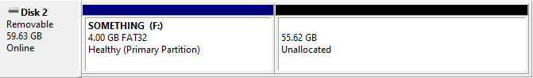

# yi-hack-v5 — fork with two-way audio (RTSP backchannel)

> **Fork of [alienatedsec/yi-hack-v5](https://github.com/alienatedsec/yi-hack-v5) (based on release 0.4.1).**
> This fork adds a working **RTSP audio backchannel** and a standalone **speaker daemon**, so a Yi 1080p Home camera can talk back — usable from Home Assistant / go2rtc / WebRTC two-way talk.
>
> Verified end-to-end on 2026-11-17 on a Yi 1080p Home 48US (y20): voice spoken into the browser is heard from the camera speaker (ear-confirmed, full-duplex in practice).

## What this fork adds

- **RTSP audio backchannel (`sendonly`)** on all three streams (`ch0_0` / `ch0_1` / `ch0_2`), in `src/rRTSPServer`. Codec selectable via `RTSP_AUDIO_BC` in `system.conf`: `aac` (default), `alaw`, `ulaw`, `none`. **`ulaw` (G.711 μ-law) is what makes WebRTC two-way talk work** — browsers cannot receive AAC over WebRTC, and the backchannel must be a codec the browser offers (PCMU).
- **`ao_daemon`** — standalone speaker daemon (`src/ao_daemon`, prebuilt static binary included). Reads decoded 16 kHz mono S16LE PCM from `/tmp/audio_in_fifo` and injects it into the speaker via the HiSilicon AO device (`/dev/ao`, ioctl nr 5), with the speaker amp switched on/off via CPLD. No LD_PRELOAD, no touching `rmm`.
- **Speaker WebUI** — "Speak" page (`speak.html`, `speak.js`) and CGI endpoints (`speaker.sh`, `speak.sh`, `speaker_file.sh`), plus `pcmvol` (ported from yi-hack-MStar).
- **Fixes to the RTSP server:**
  - `SO_REUSEPORT` wedge fixed — the camera kernel (Linux 3.4.35) predates `SO_REUSEPORT` (Linux 3.9+), so the stock port-allocation loop spun forever on the first RTSP SETUP and wedged the server. The setsockopt call is removed and the loop is bounded.
  - Backchannel wired to **all** streams — stock code only added it to `ch0_0` when `RTSP_STREAM=both`.

## How it works

```
Browser mic (Opus) -> go2rtc -> RTSP backchannel (PCMU) -> PCMFileSink
  -> S16LE 16 kHz mono -> /tmp/audio_in_fifo -> ao_daemon -> /dev/ao -> speaker
Camera mic (AAC) -> go2rtc -> Opus -> browser
```

Tested with Frigate 0.18.2 (go2rtc 1.9.14) and the Home Assistant Advanced Camera Card (`cctvkamar_talk` stream, `#backchannel=1`).

## Configuration

- `RTSP_AUDIO_BC=ulaw` in `/tmp/sd/yi-hack-v5/etc/system.conf` for WebRTC talk (the repo default is `aac`).
- `REC_WITHOUT_CLOUD=no` is recommended: local SD recording saturates the camera's single-core CPU (load ~8, 0% idle); Frigate already records to the server.
- `ao_daemon` autostarts at boot (wired into `system.sh`, verified 2026-11-18 after two reboots). See `src/ao_daemon/README.md`.

## Status and known limitations

- Two-way talk works (ear-confirmed 2026-11-17 and again 2026-11-26 after a reboot and the loudness fix). Voice was occasionally choppy: the browser mic / phone Wi-Fi delivers backchannel frames in bursts with occasional 200–400 ms gaps, which drained the camera's 200 ms AO buffer (go2rtc is a pure pass-through and does not damp them). A playout (jitter) buffer in `ao_daemon` (10 frames / 400 ms, added 2026-11-26) smooths gaps up to ~400 ms — measured with a bursty input (400 ms gaps): output gaps mean 40.1 ms / max 81 ms, 0 underruns, and ear-confirmed 2026-11-26: clear, no choppiness.
- Video/audio sync on the downlink was initially off, but is in sync now (confirmed 2026-11-18): the earlier desync was most likely caused by the camera's SD-write load, and went away after local SD recording was disabled (`REC_WITHOUT_CLOUD=no`). Note the downlink audio still goes through an ffmpeg AAC→Opus transcode while video goes direct H.264 — the transcode itself is unavoidable, since browsers cannot receive AAC over WebRTC.
- Speech was muffled/quiet (fixed 2026-11-18, ear-confirmed 2026-11-26: clearer). The μ-law oversampling filter was a low-pass (~318 Hz cutoff) attenuating speech above ~1 kHz (measured gain ~0.46). It is replaced by linear interpolation + ×2 gain — measured 4.3× louder at 1 kHz and 13.8× at 3 kHz, no clipping.
- `speak.sh` TTS reports "TTS engine not found" — `nanotts` was not ported; only the Speak page's TTS feature is affected, not WebRTC talk.
- `DEPLOY.md` describes the earlier shim-based deploy plan and is partly out of date (it lists the pre-fix server binary and `RTSP_AUDIO_BC=aac`).
- Binary assets are not in this repository: the WebUI images, watermark bitmaps, runtime `.so` libraries, `defaults.tar.bz2`, and the prebuilt `ao_daemon` binaries are not uploaded (the upload used here is text-only). Get the upstream binary assets from [alienatedsec/yi-hack-v5](https://github.com/alienatedsec/yi-hack-v5), and build `ao_daemon` from source (see Building below).

## Building

- Toolchain: Debian `gcc-arm-linux-gnueabi` 13.3.0, `-static` (the camera runs uClibc; a glibc binary will not run there).
- `src/ao_daemon/compile.ao_daemon` — builds `ao_daemon` (and `ao_daemon_test` with the `test` argument).
- `src/rRTSPServer/compile.rRTSPServer` — builds the RTSP server (applies `live555-reuseport-fix.patch` and `rRTSPServer.patch`).

## Repository layout (fork additions)

| Path | What it is |
|---|---|
| `src/rRTSPServer/` | Backchannel server-media subsessions and sinks (`*_BC`, `PCMFileSink`, `aLawAudioFilter`), the SO_REUSEPORT fix patch |
| `src/ao_daemon/` | Standalone speaker daemon (source, prebuilt binary, mock tests, README) |
| `src/ao_shim/` | Abandoned LD_PRELOAD shim — kept for reference (see below) |
| `src/www/httpd/cgi-bin/speak.sh`, `speaker.sh`, `speaker_file.sh` | Speaker CGI endpoints |
| `src/www/httpd/htdocs/pages/speak.html`, `htdocs/js/modules/speak.js` | "Speak" page |
| `src/static/.../etc/system.conf` | New `RTSP_AUDIO_BC` key |
| `DEPLOY.md` | Deploy plan (partly out of date — see above) |

## What didn't work: the LD_PRELOAD shim

`src/ao_shim` intercepts `open`/`ioctl`/`close` inside `rmm` to inject audio. It is **abandoned**: in foreground tests `rmm` died at ~5.6 s whenever the full shim was preloaded, while an empty preloaded object and each single-wrapper variant (ioctl-only, open-only, close-only) all lived the full 90 s — the killer is an interaction, most likely the open+ioctl activation path. The standalone daemon replaced it. The shim source is kept for reference only.

## Credits

- Upstream: [alienatedsec/yi-hack-v5](https://github.com/alienatedsec/yi-hack-v5) (GPL-3.0).
- Speaker design ported from [roleoroleo/yi-hack-MStar](https://github.com/roleoroleo/yi-hack-MStar) and yi-hack-Allwinner-v2 (`/tmp/audio_in_fifo`, `speaker.sh`, `speak.sh`, `pcmvol`).
- The rest of this README below is upstream's documentation for the base firmware.

## License

GNU General Public License v3.0 — see `LICENSE` (same as upstream).

---

<p align="center">
    
</p>
<p align="center">
    <a target="_blank" href="https://discord.gg/bsKncwvRU7">
        
    </a>
    <a target="_blank" href="https://github.com/alienatedsec/yi-hack-v5/releases">
        
    </a>
</p>

## Why this `YI-HACK-V5` firmware?

The answer is simple: missing updates, RTSP, and not based on the latest stock firmware (which features improvements and new cool stuff).
Besides, there were no updates to `yi-hack-v4`, and I am against that RTSP licensing model. I have contributed enough and will continue my work separately.

I am slowly working on pre-release versions, and I can see lots of downloads, testing and contributions. A big thank you to the community.

## Table of Contents

- [Features](#features)
- [Supported cameras](#supported-cameras)
- [Getting started](#getting-started)
- [Unbrick your camera](#unbrick-your-camera)
- [Acknowledgments](#acknowledgments)
- [Disclaimer](#disclaimer)
- [Donations](#donations)

## Features
This firmware will add the following features:

- **NEW FEATURES**
  - **NEW CAMERAS SUPPORTED**: Yi Outdoor 1080p and Yi Cloud Dome 1080p.
  - **RTSP server** - which will allow an RTSP stream of the video while keeping the cloud features enabled (available to all and it is free).
  - **MQTT** - detect motion directly from your home server!
  - WebServer - user-friendly stats and configurations.
  - SSH server -  _Enabled by default._
  - Telnet server -  _Disabled by default._
  - FTP server -  _Enabled by default._
  - Web server -  _Enabled by default._
  - The possibility to change some camera settings (copied from the official app):
    - camera on/off
    - video saving mode
    - detection sensitivity
    - status led
    - ir led
    - rotate
  - PTZ support through a web page.
  - Snapshot feature
  - Proxychains-ng - _Disabled by default. Useful if the camera is region-locked._
  - The possibility to disable all the cloud features while keeping the RTSP stream.

## Supported cameras

Currently, this project supports the following cameras:

- Yi 1080p Home 48US - confirmed
- Yi 1080p Home 20US - confirmed
- Yi Home 17CN / 27US / 47US - confirmed
- Yi Dome - confirmed, but heavy performance issues with Snapshot and ONVIF are killing the CPU
- Yi 1080p Dome - confirmed; however, I have no device to test
- Yi 1080p Cloud Dome - confirmed; however, I have no device to test
- Yi 1080p Outdoor - confirmed; however, I have no device to test

## Getting Started
1. Check that you have a correct Xiaomi Yi camera. (see the section above)

2. Get a microSD card, preferably of capacity 16 GB or less and format it by selecting File System as FAT32.

**_IMPORTANT: The microSD card must be formatted in FAT32. exFAT formatted microSD cards will not work._**
**I have not formatted any of my 32GB cards to load the firmware. Just copy files directly and it should work.**

<details><summary> (Click) How to format microSD cards > 32GB as FAT32 in Windows 10</summary><p>

For microSD cards larger than 32 GB, Windows 10 only gives you the option to format as NTFS or exFAT. You can create a small partition (e.g. 4 GB) on a large microSD card (e.g. 64 GB) to get the FAT32 formatting option.

* insert microSD card into PC card reader
* open Disk Management (e.g. <kbd>Win</kbd>+<kbd>x</kbd>, <kbd>k</kbd>)
  * Disk Management: delete all partitions on the microSD card
    * right click each partition > "Delete Volume..."
    * repeat until there are no partitions on the card
  * Disk Management: create a new FAT32 partition
    * Right-click on "Unallocated" > "New Simple Volume..."
    * Welcome to the New Simple Volume Wizard: click "Next"
    * Specify Volume Size: 4096 > "Next"
    * Assign Drive Letter or Path: (Any) > "Next"
    * Format Partition: Format this volume with the following settings:
      * File system: FAT32
      * Allocation unit size: Default
      * Volume label: Something
      * Perform a quick format: &#9745;

You should now have a FAT32 partition on your microSD card that will allow the camera to load the firmware files to update to `yi-hack-v5`.

### Example: 4 GB FAT32 partition on 64 GB microSD card



Alternative way:
* open cmd with admin permissions
* run diskpart
* type "list disk"
* find your SD card (for example Disk 7)
* type "select disk 7"
* if it has one partition - type "select partition 1". If more - delete all the partitions and then create one
* type "format FS=FAT32 QUICK"
* done. 32GB partition in FAT32.

</p></details>

3. Get the correct firmware files for your camera from the latest baseline release link: https://github.com/alienatedsec/yi-hack-v5/releases/tag/0.4.1

| Camera | rootfs partition | home partition | Remarks |
| --- | --- | --- | --- |
| **Yi Home 17CN / 27US / 47US** | rootfs_y18 | home_y18 | Firmware files required for the Yi Home 17CN / 27US / 47US camera. |
| **Yi 1080p Home** | rootfs_y20 | home_y20 | Firmware files required for the Yi 1080p Home camera. |
| **Yi Dome** | rootfs_v201 | home_v201 | Firmware files required for the Yi Dome camera. |
| **Yi 1080p Dome** | rootfs_h20 | home_h20 | Firmware files required for the Yi 1080p Dome camera. |
| **Yi 1080p Cloud Dome** | rootfs_y19 | home_y19 | Firmware files required for the Yi 1080p Cloud Dome camera. |
| **Yi Outdoor** | rootfs_h30 | home_h30 | Firmware files required for the Yi Outdoor camera. |

4. Save both files (rootfs_xx and home_xx), and the `yi-hack-v5` folder on the root path of the microSD card.

**_IMPORTANT: Make sure that the filenames stored on the microSD card are correct and didn't get changed. e.g. The firmware filenames for the Yi 1080p Dome camera must be home_h20 and rootfs_h20._**

5. Remove power to the camera, insert the microSD card, and turn the power back ON.

6. The yellow light will come ON and flash for roughly 30 seconds, which means the firmware is being flashed successfully. The camera will boot up.

7. The yellow light will come ON again for the final stage of flashing. This will take up to 2 minutes.

8. Blue light should come ON indicating that your WiFi connection has been successful.

9. Go into the browser and access the web interface of the camera as a website.

Depending upon your network setup, accessing the web interface with the hostname **may not work**. In this case, the IP address of the camera has to be found.

This can be done from the App. Please open the app, and go to the Camera Settings --> Network Info --> IP Address.

Access the web interface by entering the IP address of the camera in a web browser. e.g. `http://192.168.1.5`

**_IMPORTANT: If you have multiple cameras. It is important to configure each camera with a unique hostname. Otherwise, the web interface will only be accessible by IP address._**

10. Done! You are now successfully running yi-hack-v5!

## Unbrick your camera
_TO DO - (It happened a few times and it's often possible to recover from it)_

## Troubleshooting

### Wi-Fi is connected, and the camera responds to ping but I'm not able to connect to the web interface
Verify that you did not forget to upload the `yi-hack-v5` folder to the SD card when uploading firmware. If you did, upload it and restart the camera.

### Cannot complete the pairing/wifi settings lost after reboot
Ensure you are using the correct app (Yi Home) to set up the wifi connection. For example, the "Xiaomi Home" app will also generate the correct QR code that will work with your camera for the initial connection, but then after power is removed
the settings will be lost.

## Introducing pre-releases
Please follow this [guide](https://github.com/alienatedsec/yi-hack-v5/discussions/248#discussion-5090628) if you want to test new features and improvements

## Acknowledgments
Special thanks to the following people and projects, without them `yi-hack-v5` wouldn't be possible.
- @TheCrypt0 - [https://github.com/TheCrypt0/yi-hack-v4](https://github.com/TheCrypt0/yi-hack-v4)
- @shadow-1 - [https://github.com/shadow-1/yi-hack-v3](https://github.com/shadow-1/yi-hack-v3)
- @fritz-smh - [https://github.com/fritz-smh/yi-hack](https://github.com/fritz-smh/yi-hack)
- @niclet  - [https://github.com/niclet/yi-hack-v2](https://github.com/niclet/yi-hack-v2)
- @xmflsct -  [https://github.com/xmflsct/yi-hack-1080p](https://github.com/xmflsct/yi-hack-1080p)
- @dvv - [Ideas for the RSTP stream](https://github.com/shadow-1/yi-hack-v3/issues/126)
- @andy2301 - [Ideas for the RSTP rtsp and rtsp2301](https://github.com/xmflsct/yi-hack-1080p/issues/5#issuecomment-294326131)
- @roleoroleo - [PTZ Implementation](https://github.com/roleoroleo/yi-hack-MStar)

## Acknowledgments #2
As much as TheCrypt0 has made it possible for the 'yi-hack-v4', the latest features are based on the work from:
- @roleoroleo - [https://github.com/roleoroleo](https://github.com/roleoroleo)

---
### DISCLAIMER
**I AM NOT RESPONSIBLE FOR ANY USE OR DAMAGE THIS SOFTWARE MAY CAUSE. THIS IS INTENDED FOR EDUCATIONAL PURPOSES ONLY. USE AT YOUR OWN RISK.**
---
### DONATIONS
**I HAVE BEEN ASKED FOR A LINK MULTIPLE TIMES; THEREFORE, PLEASE FOLLOW THE BELOW**
---
[](https://www.paypal.com/cgi-bin/webscr?cmd=_s-xclick&hosted_button_id=K3V4PSH2CV9AA)
